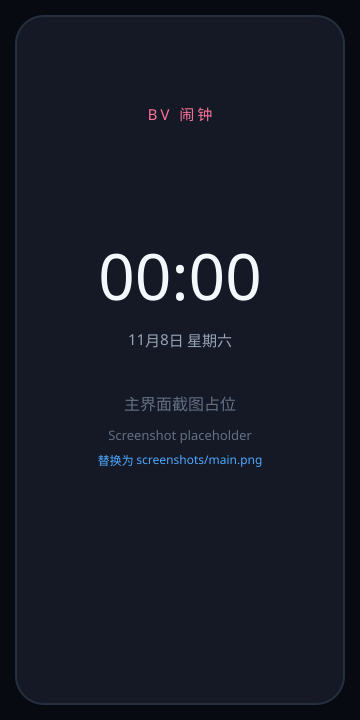

# BV闹钟

一个轻量的 Android 闹钟：**闹钟铃声可以直接用 B 站视频里的声音，填 BV 号即可。**

## 截图

<p align="center">
  
</p>

> 当前为占位图。安装后可用 `adb exec-out screencap -p > screenshots/main.png` 截图并替换引用。

- 包名：`com.bvalarm.app`
- 版本：1.7
- 最低系统：Android 8.0（API 26）
- 目标系统：Android 14（API 34）
- 安装包：`BVAlarm-1.7.apk`（约 122 KB）

---

## 功能

- **精确闹钟**：使用 `AlarmManager.setAlarmClock`，到点唤醒，Doze 下也能响，系统状态栏会显示"下一个闹钟"。
- **重复方式**：仅一次 / 每天 / 工作日 / 周末 / 任意星期组合。
- **B 站铃声**：输入 BV 号、视频链接或 b23 短链，解析后把音频下载到手机本地，**响铃时不需要联网**。
- **全屏响铃界面**：锁屏上显示大时间、标签、铃声来源，可"停止"或"稍后提醒"。
- **响铃音量增强（可关闭）**：响铃时临时把闹钟音量拉到最大，并用音频增益补偿偏小的 B 站音源；停止后恢复原音量。
- **通知栏控制**：停止 / 稍后提醒；响铃 10 分钟自动停止。
- **稍后提醒**：5 / 10 / 15 / 20 / 30 分钟可选。
- **响铃时长**：1 / 5 / 10 / 30 / 60 分钟可选（默认 10 分钟）。
- **渐强音量**：响铃 20 秒内从静音缓入到最大，不再突然炸响。
- **跳过下一次**：长按闹钟可"跳过下一次"，到点不响并自动排到下次。
- **一键试响**：长按闹钟可直接试听该闹钟的铃声。
- **主页实时时钟**：顶部大字时钟 + 日期。
- **浅色 / 深色主题**：主菜单可一键切换。
- **AI 提示语**：主页与响铃页随机显示一句提示，首次打开有弹窗说明。
- **使用说明 / 关于**：独立页面。
- **标签、震动开关**。
- **自动恢复**：重启、应用更新、修改系统时间/时区后自动重新排程。
- 无广告、无账号、不收集任何数据。

---

## 安装

```bash
adb install -r BVAlarm-1.7.apk
```

或把 APK 传到手机，用文件管理器点击安装（需允许"安装未知应用"）。

> 这是自签名 APK。如果手机上装过用其他签名打包的同包名版本，需要先卸载旧版。

---

## 首次打开：请务必完成这三步

不设置也能用，但**闹钟可能不准时或没有全屏提醒**：

1. **允许通知**（Android 13+ 会弹窗）
   - 响铃全屏界面依赖通知，拒绝后可能只有声音。
2. **允许"闹钟和提醒"**
   - 设置 → 应用 → 特殊应用权限 → 闹钟和提醒 → BV闹钟 → 允许。
   - 应用首页顶部的黄色横幅可以直接点进去。
3. **关闭电池优化 / 允许自启动**
   - 设置 → 应用 → BV闹钟 → 耗电管理 / 自启动（国产 ROM 名称不同）。
   - 小米、华为、OPPO、vivo 等建议同时在多任务里给应用加锁。

---

## 使用步骤

1. 打开应用，点右下角 **+**。
2. 点大时间，选择时和分（24 小时制）。
3. 选择重复的星期（可点"每天 / 工作日 / 周末"快捷设置）。
4. 在"闹钟铃声"卡片里点 **用 B站 音频**。
5. 粘贴 BV 号或视频链接，例如：

   ```
   BV1GJ411x7h7
   https://www.bilibili.com/video/BV1GJ411x7h7
   https://b23.tv/xxxxxxx
   ```

6. 点 **解析并下载**，等待进度条完成，可以点 **▶** 试听。
7. 勾选 **"响铃时自动调大音量"**（默认已勾选）。它会临时把系统闹钟音量拉到最大，并对音源做 +7 dB 增益；停止响铃后恢复。
8. 点 **保存闹钟**。

到点后会全屏响铃；点 **停止** 结束，点 **稍后提醒** 按设定的分钟数再响一次。

### 支持的输入

| 输入 | 说明 |
| --- | --- |
| `BV1GJ411x7h7` | 标准 BV 号 |
| `https://www.bilibili.com/video/BV...` | 完整视频链接 |
| `https://b23.tv/xxxx` | 短链，会自动跟随跳转 |
| 链接带 `?p=2` | 多 P 视频指定第 2 个分 P |

---

## 已知限制

- **解析和下载需要联网一次**；下载完成后，响铃完全离线。
- **付费 / 大会员 / 地区限制**的视频可能拿不到音频。此时会明确提示，并自动使用系统默认铃声——**闹钟本身不会不响**。
- 下载的音频保存在应用私有目录（`/data/data/com.bvalarm.app/files/ringtones/`），**卸载应用会一起删除**。
- 单个音频最大 60 MB（DASH 音轨），备用音轨最大 220 MB；特别长的视频可能超出限制。
- 响铃时长默认 10 分钟（可在编辑页选 1~60 分钟）自动停止，避免无限响。
- 被系统"强行停止"的应用无法自动恢复闹钟（Android 平台限制）；重启手机可以恢复。
- 不同厂商的省电策略差异较大，必要时请按上面的"三步"设置。

---

## 实现说明（想改代码的人看）

整个应用是**纯 framework Java 8**，没有 AndroidX、没有 Gradle 依赖，因此可以完全离线用 SDK 命令行工具构建。

### 核心链路

```
AlarmManager.setAlarmClock
        │  到点
        ▼
AlarmReceiver (BroadcastReceiver)
        │  startForegroundService
        ▼
RingService (前台服务, mediaPlayback)
        ├─ MediaPlayer(USAGE_ALARM) 播放本地铃声 / 系统默认铃声
        ├─ Vibrator 循环震动
        └─ 高优先级通知 + fullScreenIntent
                 │
                 ▼
          RingActivity（锁屏全屏界面）
           停止 / 稍后提醒 → 回传 Service
```

### B 站音频解析

1. `https://api.bilibili.com/x/web-interface/view?bvid=BV...`
   拿到标题、UP 主、cid、分 P 列表。
2. `https://api.bilibili.com/x/player/playurl?bvid=...&cid=...&fnval=16`
   拿到 DASH 音频流（AAC，`m4s`，Fragment MP4），优先选 192k / 132k / 64k。
3. 如果 DASH 不可用，回退到
   `...&qn=16&fnval=0&fourk=0&platform=html5`
   拿到带音轨的 MP4（体积更大，但兼容性最好）。
4. 下载时附带 `Referer: https://www.bilibili.com/` 和桌面 UA，否则 CDN 会返回 403。
5. 下载后用 `MediaMetadataRetriever` 验证能否解码；DASH 音轨不行就自动改用备用 MP4。

### 其他

- 数据存储：`SharedPreferences` 里的一段 JSON 数组。
- 无精确闹钟权限时：`setAlarmClock` → `setExactAndAllowWhileIdle` → `set` 逐级降级，并在首页提示。
- 关闭闹钟/删除闹钟时会同时取消已排队的"稍后提醒"。

### 项目结构

```
bvalarm/
├── AndroidManifest.xml
├── build.ps1                  # 一条命令构建、签名 APK
├── src/com/bvalarm/app/
│   ├── MainActivity.java      # 闹钟列表 + 实时时钟
│   ├── EditActivity.java      # 新建/编辑，BV 解析与下载
│   ├── RingActivity.java      # 全屏响铃界面
│   ├── RingService.java       # 前台响铃服务
│   ├── AlarmReceiver.java     # 精确闹钟广播
│   ├── BootReceiver.java      # 重启/更新/改时间后恢复
│   ├── AboutActivity.java     # 关于页面
│   ├── HelpActivity.java      # 使用说明页面
│   ├── ThemeManager.java      # 浅色/深色主题切换
│   ├── AiTips.java            # AI 提示语词库
│   ├── Alarm.java             # 模型 + 下次触发时间计算
│   ├── AlarmStore.java        # JSON 持久化
│   ├── AlarmScheduler.java    # AlarmManager 封装
│   ├── AlarmAdapter.java      # 列表适配器
│   ├── BiliApi.java           # B 站接口解析
│   ├── RingtoneDownloader.java# 下载 + 可播放性校验
│   └── Ui.java                # 工具方法
├── res/                       # 布局、颜色、图标
└── tests/                     # 调度逻辑测试、资源引用检查、接口实测
```

---

## 自己编译

需要：

- JDK 11
- Android SDK `build-tools;34.0.0` 和 `platforms;android-34`

把 SDK 放到项目上一级的 `.android-sdk/`（或修改 `build.ps1` 顶部的 `$sdk`），然后：

```powershell
pwsh -File build.ps1
```

脚本会依次执行：`aapt2 compile` → `aapt2 link` → `javac` → `d8` → 打包 `classes.dex` → `zipalign` → `apksigner`，产物是 `BVAlarm-1.7.apk`。

签名密钥在 `keystore/bvalarm.keystore`（口令 `bvalarm123`，仅用于个人安装；正式发布请换成自己的密钥）。该密钥已被 `.gitignore` 排除，不会随仓库上传；首次构建时 `build.ps1` 会自动生成。

---

## 已验证 / 未验证

**已在本机验证：**

- `BiliApi` 在本机 JVM 上真实请求 B 站接口成功：拿到标题、cid、DASH 音频地址；CDN 带 Referer 返回 206 和正确的 ftyp 头。
- 下载的 `m4s` 用 ffprobe 检查为 **AAC 48 kHz 立体声、212 秒**，是合法的 Fragment MP4。
- `Alarm.nextTrigger()` 的 8 组时间计算用例（仅一次/工作日/周末/每天/边界时间）全部通过。
- Java 里引用的所有资源 ID、布局 ID 与 XML 一一对应，无缺失。
- APK 通过 `apksigner verify`（v2/v3 签名）和 `zipalign -c` 校验。

**未验证：**

- 本环境没有安卓真机/模拟器（adb 无法启动），因此**没有做真机安装与响铃测试**。
- 全屏通知、锁屏显示、各厂商后台策略等依赖真机行为，请在手机上实际试一次"1 分钟后响铃"。
- `LoudnessEnhancer` 音量增强在不同机型/ROM 上的实际效果可能不同；如果设备不支持，仍会执行"闹钟音量拉到最大"这一层增强。

---

## 隐私

- 只访问 `api.bilibili.com` 和 B 站视频 CDN。
- 不登录、不带 Cookie、不上传任何数据、无统计 SDK。

---

## 常见问题

**保存时提示"请先解析并下载 B站 铃声"？**
铃声选择还停留在 B 站音频，但文件没下载成功。点"解析并下载"完成后保存，或点"默认铃声"。

**下载失败怎么办？**
换一个 BV 号试试；付费、地区限制、已删除的视频无法获取音频。错误信息会显示在按钮下方。

**闹钟不响 / 响得晚？**
检查通知权限、"闹钟和提醒"权限、电池优化；国产 ROM 还需要允许自启动。

**声音太小？**
1. 编辑闹钟，确认 **"响铃时自动调大音量"** 已勾选（v1.1 默认勾选）。
2. 它会临时把 **闹钟音量**（注意不是媒体音量）拉到最大，并给 B 站音源加 +7 dB 增益；停止后恢复。
3. **试听用的是媒体音量，响铃用的是闹钟音量**，两者是分开的；试听偏小不代表响铃小。
4. 如果还是小，换一个本身比较响的 B 站视频；部分视频的响度确实很低。
5. 检查是否连着蓝牙耳机/音箱——闹钟通常走扬声器，但也可能被音频路由带走。
6. 在系统设置里把"闹钟音量"滑块调大（响铃时会被自动拉满，但有的 ROM 会锁定）。

**能离线响吗？**
可以。铃声在设置时已经下载到本地，响铃不联网。

**换手机/重装应用铃声还在吗？**
不在。音频存在应用私有目录，卸载即删除，需要重新下载。
